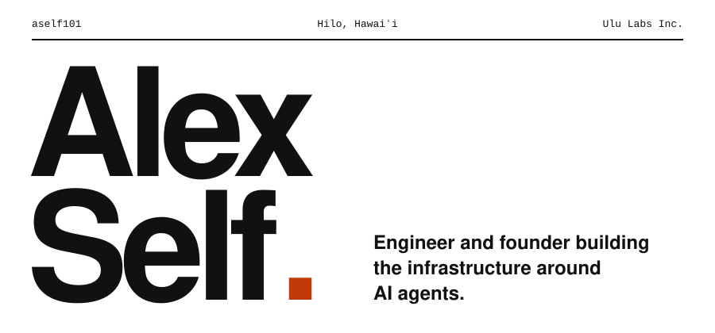

<p align="center">
  <picture>
    <source media="(prefers-color-scheme: dark)" srcset="assets/header-swiss-dark.svg">
    
  </picture>
</p>

**I build infrastructure for AI agents.** UluOps is a registry, a tracker and an orchestration library: agents defined in versioned YAML, evaluated over time, run from TypeScript. Background in computer science, political science and astronomy, with years of software for agriculture.

## Last shipped

<!-- SHIPPED:START -->
```text
@uluops/setup         0.20.0  2026-10-30
@uluops/cli           0.42.0  2026-10-27
@uluops/core          0.54.0  2026-10-27
@uluops/registry-mcp  0.18.0  2026-10-25
@uluops/ops-mcp       0.34.0  2026-10-25
```
<!-- SHIPPED:END -->

## Index of work

<!-- PACKAGES:START -->
### Apps

| # | Project | Latest | Shipped | What it is |
| :-- | :-- | :-- | :-- | :-- |
| 01 | [**UluOps Registry** ↗](https://registry.uluops.ai) | `live` | - | Versioned YAML definitions for agents |
| 02 | [**UluOps Tracker** ↗](https://app.uluops.ai) | `live` | - | Longitudinal eval framework: track how agents perform over time |

### Packages

| # | Project | Latest | Shipped | What it is |
| :-- | :-- | :-- | :-- | :-- |
| 03 | [**@uluops/core** ↗](https://www.npmjs.com/package/@uluops/core) | `0.54.0` | 2026-10-27 | Execution engine: agents, commands, workflows and pipelines |
| 04 | [**@uluops/cli** ↗](https://www.npmjs.com/package/@uluops/cli) | `0.42.0` | 2026-10-27 | `ulu`: runs, findings, issues and the registry from one command |
| 05 | [**@uluops/ops-sdk** ↗](https://www.npmjs.com/package/@uluops/ops-sdk) | `7.1.0` | 2026-10-25 | Typed TypeScript client for the tracker API |
| 06 | [**@uluops/ops-mcp** ↗](https://www.npmjs.com/package/@uluops/ops-mcp) | `0.34.0` | 2026-10-25 | MCP server for the tracker: runs, findings, issues, analytics |
| 07 | [**@uluops/registry-sdk** ↗](https://www.npmjs.com/package/@uluops/registry-sdk) | `0.64.1` | 2026-10-25 | SDK for the Registry API |
| 08 | [**@uluops/registry-mcp** ↗](https://www.npmjs.com/package/@uluops/registry-mcp) | `0.18.0` | 2026-10-25 | MCP server for the Registry: definitions, versions, analytics |
| 09 | [**@uluops/sdk-core** ↗](https://www.npmjs.com/package/@uluops/sdk-core) | `0.19.0` | 2026-10-03 | Shared infrastructure for the UluOps SDKs |
| 10 | [**@uluops/setup** ↗](https://www.npmjs.com/package/@uluops/setup) | `0.20.0` | 2026-10-30 | Installer for UluOps agentic harnesses |
| 11 | [**@uluops/taxonomy** ↗](https://www.npmjs.com/package/@uluops/taxonomy) | `1.1.0` | 2026-08-22 | The UluOps failure taxonomy: 4 domains, 28 modes, 5 severities |
| 12 | [**@uluops/agent-metrics** ↗](https://www.npmjs.com/package/@uluops/agent-metrics) | `0.12.1` | 2026-10-19 | Metrics from Claude Code and Codex session files |
| 13 | [**mcp-secure-server** ↗](https://www.npmjs.com/package/mcp-secure-server) | `0.1.1-security` | 2026-10-25 | Secure-by-default MCP server with 5-layer validation |

### Projects

| # | Project | Latest | Shipped | What it is |
| :-- | :-- | :-- | :-- | :-- |
| 14 | [**darkroom** ↗](https://github.com/aself101/darkroom) | `main` | 2026-09-24 | Local studio for image and video generation |
<!-- PACKAGES:END -->

## Now

- Agent evals and orchestration at Ulu Labs
- Orchards by day, a lilikoi patch by evening

## Stack

TypeScript · Node.js · Python · MCP · YAML · DBs

## Contact

[**alexself.dev**](https://alexself.dev) · [email](mailto:aself@ululabs.ai) · [LinkedIn](https://www.linkedin.com/in/alexander-self)
