<p align="center">
  
</p>

```console
$ cat about.txt
I build infrastructure for AI agents: a registry that versions them,
a tracker that measures them over time, and a library that orchestrates
them. Before that: agricultural software, astronomy, political science.
```

<!-- SHIPPED:START -->
```console
$ ./last-shipped
mcp-secure-server  0.0.27-security  2026-10-13
@uluops/cli        0.39.0           2026-10-10
@uluops/ops-mcp    0.31.0           2026-10-10
@uluops/ops-sdk    6.17.0           2026-10-10
@uluops/setup      0.16.0           2026-10-09
```
<!-- SHIPPED:END -->

<!-- PACKAGES:START -->
```console
$ ls ./apps
```

| Project | Latest | Shipped | What it is |
| :-- | :-- | :-- | :-- |
| [`UluOps Registry`](https://registry.uluops.ai) | `live` | - | Versioned YAML definitions for agents |
| [`UluOps Tracker`](https://app.uluops.ai) | `live` | - | Longitudinal eval framework: track how agents perform over time |

```console
$ ls ./packages
```

| Project | Latest | Shipped | What it is |
| :-- | :-- | :-- | :-- |
| [`@uluops/core`](https://www.npmjs.com/package/@uluops/core) | `0.51.0` | 2026-10-09 | Execution engine: agents, commands, workflows and pipelines |
| [`@uluops/cli`](https://www.npmjs.com/package/@uluops/cli) | `0.39.0` | 2026-10-10 | `ulu`: runs, findings, issues and the registry from one command |
| [`@uluops/ops-sdk`](https://www.npmjs.com/package/@uluops/ops-sdk) | `6.17.0` | 2026-10-10 | Typed TypeScript client for the tracker API |
| [`@uluops/ops-mcp`](https://www.npmjs.com/package/@uluops/ops-mcp) | `0.31.0` | 2026-10-10 | MCP server for the tracker: runs, findings, issues, analytics |
| [`@uluops/registry-sdk`](https://www.npmjs.com/package/@uluops/registry-sdk) | `0.61.0` | 2026-10-08 | SDK for the Registry API |
| [`@uluops/registry-mcp`](https://www.npmjs.com/package/@uluops/registry-mcp) | `0.15.0` | 2026-10-09 | MCP server for the Registry: definitions, versions, analytics |
| [`@uluops/sdk-core`](https://www.npmjs.com/package/@uluops/sdk-core) | `0.19.0` | 2026-10-03 | Shared infrastructure for the UluOps SDKs |
| [`@uluops/setup`](https://www.npmjs.com/package/@uluops/setup) | `0.16.0` | 2026-10-09 | Installer for UluOps agentic harnesses |
| [`@uluops/taxonomy`](https://www.npmjs.com/package/@uluops/taxonomy) | `1.1.0` | 2026-08-22 | The UluOps failure taxonomy: 4 domains, 28 modes, 5 severities |
| [`@uluops/agent-metrics`](https://www.npmjs.com/package/@uluops/agent-metrics) | `0.12.0` | 2026-10-04 | Metrics from Claude Code and Codex session files |
| [`mcp-secure-server`](https://www.npmjs.com/package/mcp-secure-server) | `0.0.27-security` | 2026-10-13 | Secure-by-default MCP server with 5-layer validation |

```console
$ ls ./projects
```

| Project | Latest | Shipped | What it is |
| :-- | :-- | :-- | :-- |
| [`darkroom`](https://github.com/aself101/darkroom) | `public` | - | Local studio for image and video generation |
<!-- PACKAGES:END -->

```console
$ cat now.txt
- agent evals and orchestration at Ulu Labs
- orchards by day, a lilikoi patch by evening
```

```console
$ cat stack.txt
TypeScript · Node.js · MCP · YAML
```

```console
$ ./contact
```

[**alexself.dev**](https://alexself.dev) · [email](mailto:your@email.here) · [LinkedIn](https://www.linkedin.com/in/your-handle)
